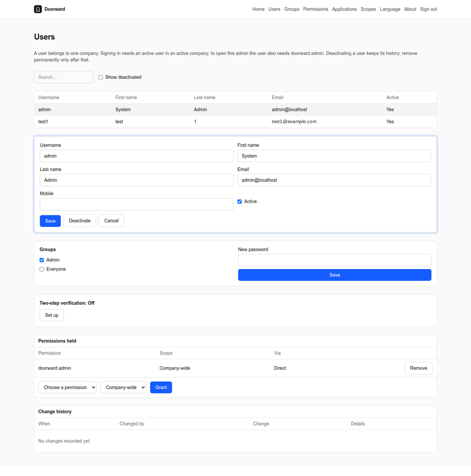
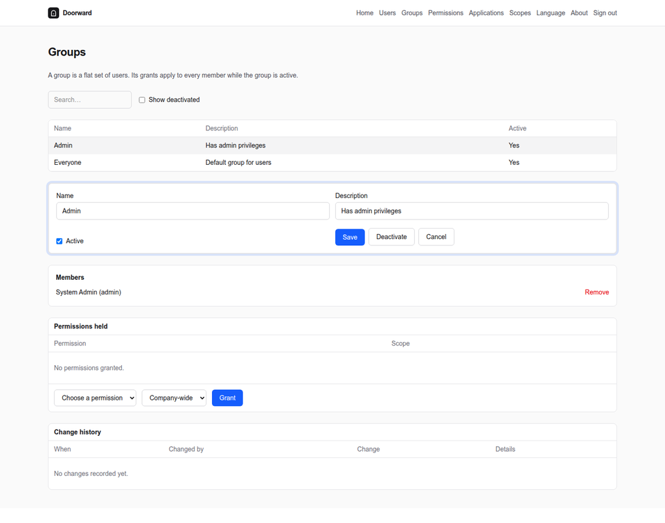
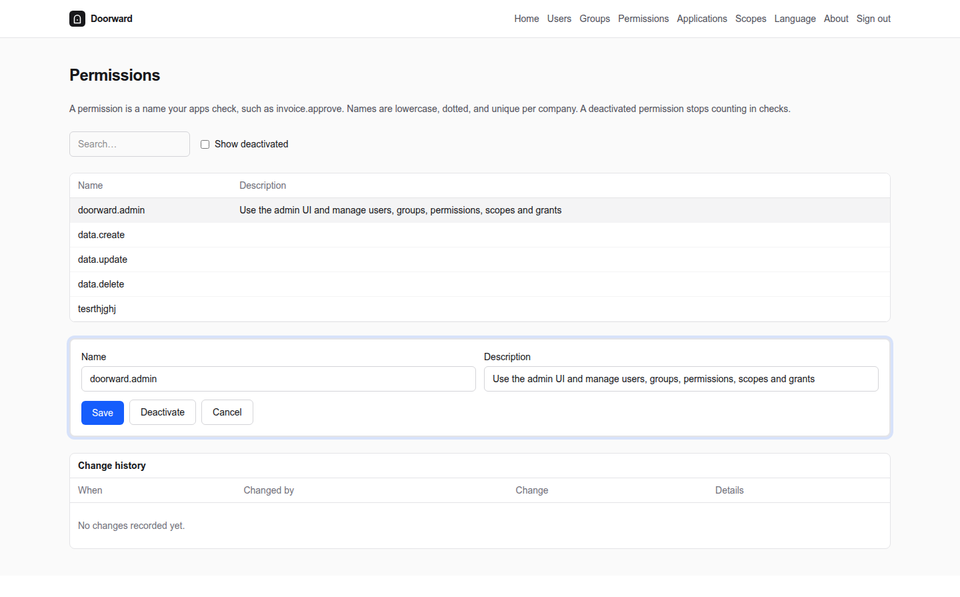
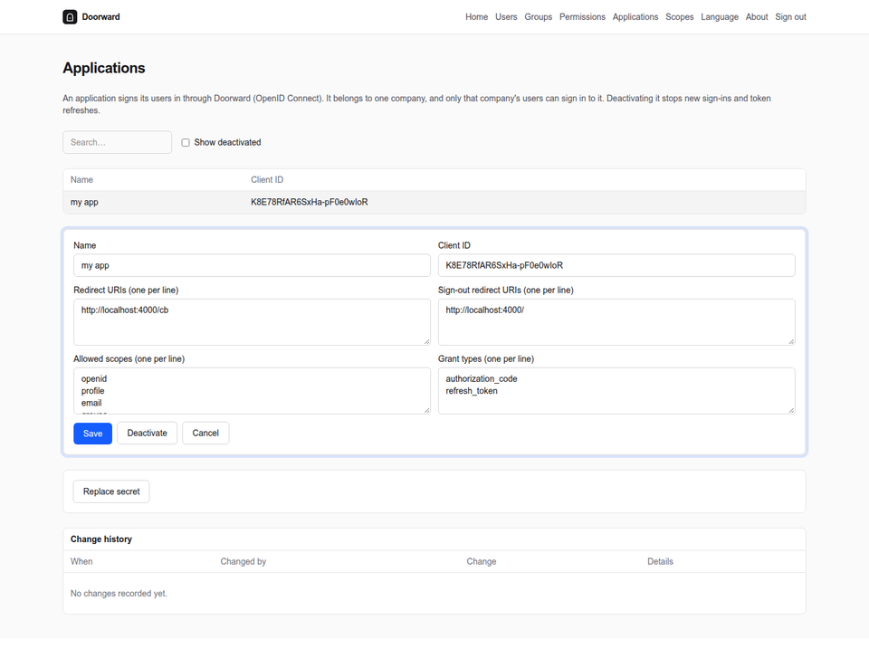
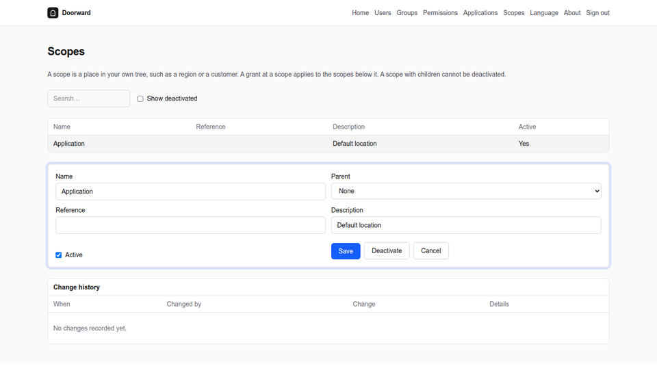
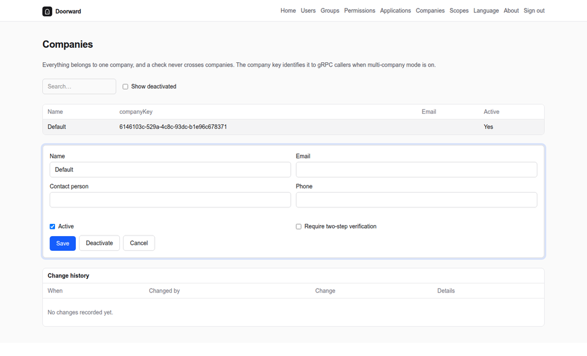
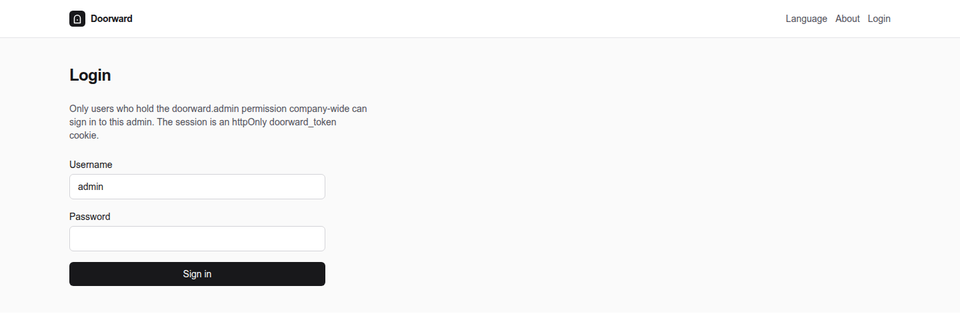
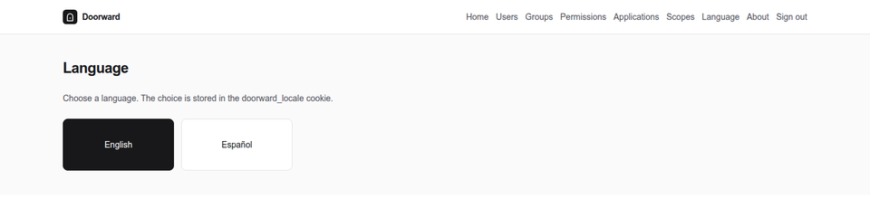

#  Doorward

Doorward is a self-hosted service for managing **users**, **groups**, and **permissions**. One NestJS process serves a REST API for the admin console and a gRPC API for your applications, backed by your own PostgreSQL or SQL Server database.

Here is the local admin console right after sign-in. You can see who holds which permissions, where each grant comes from, and the audit history behind every change.



## How it works

Administrators use the web console to create user accounts, organize people into groups, and grant or revoke permissions. Your applications talk to Doorward over gRPC (`doorward.v1`) instead of querying the database, or over REST with a bearer token if they only speak HTTP.

- **One authorization question:** You define dotted permission names like `invoice.approve` and grant them to a user or a group, either company-wide or at a specific scope. Your app calls `Check` and gets back a yes/no answer along with the exact grant that matched.
- **One process, two APIs:** The same NestJS server listens for REST on port `3001` and gRPC on port `5581`. The Next.js console uses JSON over REST, and backend services use protobuf over gRPC. The `.proto` files in `packages/proto` define the shared contract.
- **Your own database:** Versioned SQL migrations build the schema (eleven tables) in PostgreSQL or SQL Server. Doorward hashes passwords with argon2id and writes every update and deletion to `users.audit_log` inside the same database transaction.
- **Client examples included:** The repo ships working examples for C#, C++, Rust, Node.js, and curl. For any other language, generate a client from the `.proto` file.

Across the codebase, database schema, and UI, access rights are called **Permissions**.

## When to use Doorward

- You want to ask one question (may this user do this at this scope?) and see the exact grant that matched.
- You run PostgreSQL or SQL Server and want a scope tree (where a parent grant covers its children) plus an admin console.
- You want Doorward to store passwords and handle sign-in with OpenID Connect and TOTP.

## Not in this version yet

Password reset, invites, email verification, SCIM, and sign-in through Google, Entra ID, Okta, SAML, or LDAP are not built. Doorward stores passwords itself and signs users in as an OpenID Connect provider. Keycloak and Ory already ship those account and directory features if you need them now.

## Rules a Check follows today

These are the rules of the current model. A Check can name the one grant that allowed the answer.

- Grants are allow-only. There is no deny row.
- A permission name matches exactly. There are no wildcards.
- Groups are flat, and a group is the bundle of grants. There is no second "role" object.
- A grant on a scope covers that scope and every scope under it. Doorward does not store arbitrary relationships between objects, which is the model OpenFGA and SpiceDB use.

## When the shape is wrong

You want the rules to run inside your own process. Casbin is that kind of library. Doorward is a service your applications call.

## Inside the admin console

**Groups** are flat collections of users. Every active member inherits all grants assigned to their groups.



**Permissions** are the capability names your applications check.



**Applications** are OpenID Connect clients that let users sign in through Doorward. A fresh database starts with none; the local screenshot below shows a client named `my app`.



**Scopes** form a tree that defines where a grant applies, such as application modules, customer areas, or physical locations like regions and buildings. A grant at a parent scope covers every child scope beneath it (see [Scopes](docs/domain.md#scopes)). **Companies** are tenants. The Companies page stays hidden until you set `NEXT_PUBLIC_MULTI_COMPANY_MODE=true`.

| Scopes | Companies |
| --- | --- |
|  |  |

The admin console stores sessions in an `httpOnly` cookie named `doorward_token` instead of `localStorage`, and includes both English and Spanish translations.

| Sign in | Language |
| --- | --- |
|  |  |

## Run locally

Prerequisites:

- Node.js 24 LTS (`>=24.21.0 <25`), matching `.nvmrc`
- pnpm 12 (see `packageManager` in `package.json`)

Install dependencies, generate the local `.env` files, run migrations and seed data, and start the dev servers:

```bash
pnpm install
node scripts/write-local-env.mjs
pnpm --filter @doorward/domain build && pnpm --filter @doorward/api build   # db:migrate runs the built CLI
pnpm db:migrate   # create the schema in your empty `doorward` database
pnpm db:seed      # default company and the admin user
pnpm dev
```

Open [http://localhost:3000](http://localhost:3000) and sign in with `admin` / `changeme`. Change that password before you deploy to any shared environment. The REST API listens on port `3001` (with OpenAPI docs at `/api/docs`), and gRPC listens on port `5581`.

`write-local-env.mjs` creates gitignored `.env` files with local defaults. Both the API and the web app exit at startup if a required variable is missing. Keep `GRPC_API_KEY` separate from `JWT_SECRET`, and set `COOKIE_SECURE=true` only when serving over HTTPS. See [docs/environment.md](docs/environment.md) for the full list of variables.

## Calling Doorward from your application

Backend services should connect over gRPC. When `GRPC_API_KEY` is set on the server, pass it in the `x-api-key` metadata header to call any RPC. If a service only needs permission checks, give it `GRPC_CHECK_API_KEY` instead; that key can only call `Check` and `BatchCheck`. Call `Authenticate` to verify credentials, then call `Check` to verify permissions. Never forward the admin session cookie to backend apps or reuse `JWT_SECRET` as a gRPC key.

If an app can only speak HTTP, send the check-only key in `x-api-key` to `POST /api/v1/check`. A signed-in user can also call that route for their own user ID. Managing users and grants over HTTP requires a bearer token from `POST /api/auth/token` (using an account with `doorward.admin`), sent as `Authorization: Bearer <token>` on `/api/v1`. The session cookie from `POST /api/auth/login` is for the admin console.

| Language | Example | Transport |
| --- | --- | --- |
| C# (.NET, layered) | [`examples/csharp`](examples/csharp) | gRPC |
| C++ (CMake) | [`examples/cpp`](examples/cpp) | gRPC |
| Rust (tonic) | [`examples/rust`](examples/rust) | gRPC |
| Node.js | [`examples/grpc-client`](examples/grpc-client) | gRPC |
| curl + jq | [`examples/rest`](examples/rest) | REST bearer token |

Every example runs the same walkthrough: authenticate a user, check `doorward.admin`, list the user's grants and all users, and create four sample permissions if they are missing. New users have no permissions until you grant them. See [docs/integrate.md](docs/integrate.md) for the full integration guide.

## Self-hosting with Docker Compose

Start PostgreSQL, the API (`3001` HTTP, `5581` gRPC), and the web console (`3000`):

```bash
pnpm compose:up
```

To run SQL Server instead of PostgreSQL, use `pnpm compose:up:mssql`. If port `5432` is already taken on your machine, override it with `POSTGRES_HOST_PORT=5433 pnpm compose:up`.

You can host the **web** app on Vercel, while the NestJS API needs a long-lived host for its gRPC socket. See [docs/deploy.md](docs/deploy.md) for deployment options.

## Repository layout

| Path | Description |
| --- | --- |
| `apps/api` | NestJS 12 backend serving HTTP and gRPC (`@doorward/api`) |
| `apps/web` | Next.js 16 admin console (`@doorward/web`) |
| `packages/proto` | Protobuf definitions and generated types (`@doorward/proto`) |
| `packages/domain` | Shared domain enums and constants |
| `db/postgres`, `db/mssql` | SQL setup and seed packs for `doorward` |
| `examples/` | Integration examples in C#, C++, Rust, Node.js, and REST |
| `docs/` | Guides and reference documentation |
| `deploy/compose` | Docker Compose setup (`deploy/vercel` is web-only) |

For the contributor glossary and architecture summary, read [CONTEXT.md](CONTEXT.md).

## Security

The seeded admin account uses `admin` / `changeme`. Before exposing Doorward to a network, change that password, generate a strong `JWT_SECRET`, turn on gRPC TLS, and set `GRPC_API_KEY`. See [SECURITY.md](SECURITY.md) for the checklist and vulnerability reporting instructions.

## Documentation

- [Guide](docs/guide.md): visual walkthrough with diagrams covering architecture, initial setup, `Check`, SSO, and two-step verification
- [Domain](docs/domain.md): core concepts (users, groups, permissions, grants, scopes, and `Check`)
- [Database](docs/database.md): the `users` schema and the PostgreSQL / SQL Server packs
- [gRPC](docs/grpc.md): `doorward.v1` services, TLS setup, and API key authentication
- [Integrate](docs/integrate.md): how backend apps authenticate users and check permissions
- [Sign in with Doorward (OpenID Connect)](docs/sso.md): SSO setup, client configuration, claims, two-step verification, and troubleshooting
- [Logging](docs/logging.md): JSON logs on stdout, request IDs, redaction, and log collection on Compose, AWS, and GCP
- [Environment](docs/environment.md): reference for all required and optional environment variables
- [Deploy](docs/deploy.md): self-hosting with Docker Compose, cloud deployments, and Vercel

## Contributing and license

See [CONTRIBUTING.md](CONTRIBUTING.md). Licensed under the [MIT License](LICENSE).
