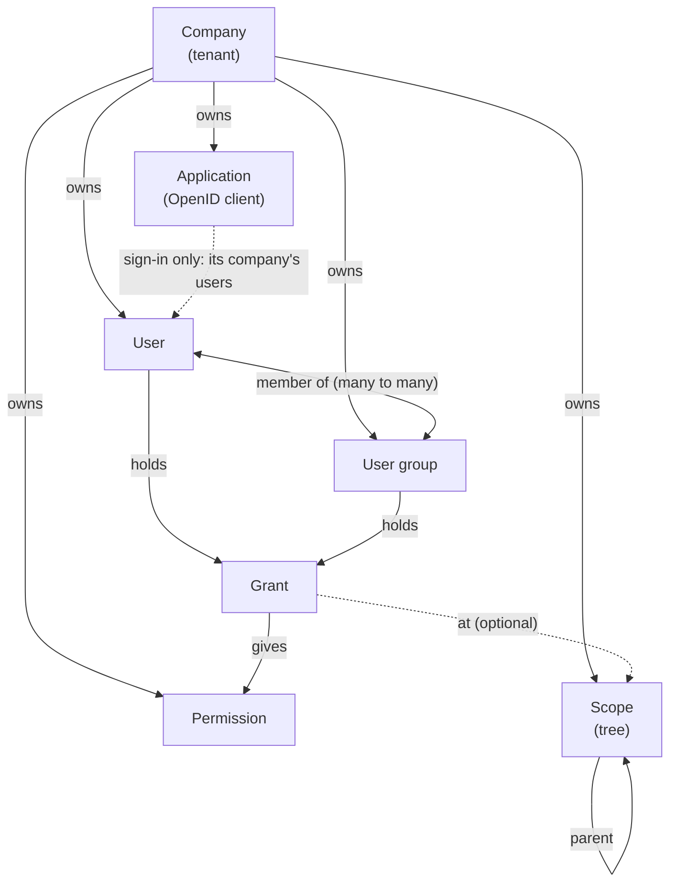

# Domain Model

Doorward manages six entities: **users**, **user groups**, **permissions**, **scopes** (where a permission applies), **grants** (who holds which permission and where), and **companies** (tenants).

Your applications ask Doorward one question: *does this user hold this permission at this scope?* That lookup is a **Check**.

## Data model

```
company ─┬─ user ──┬─ grant ── permission
         ├─ user_group ─┘        │
         │   └─ user_group_member (user ↔ group)
         ├─ permission           └── scope (optional; tree)
         └─ scope (tree)
```

| Concept | Description |
| --- | --- |
| **Permission** | A named capability like `invoice.approve`. Names use lowercase dotted notation and are unique within a company. |
| **Scope** | A node in a tree that defines where a grant applies. |
| **Grant** | Links one permission to one user **or** one user group, either at a scope or company-wide. |
| **User group** | A flat collection of users. Active members inherit all grants on the group. |

## Rules

1. **Sign-in only checks identity.** Authentication succeeds when the user exists, is active, is not deleted, belongs to an active company, and gives the right password (verified with argon2id). There is no special "can log in" permission. The admin console checks for `doorward.admin` the same way any other app checks a permission, so any app can reuse Doorward for sign-in.
2. **Groups are flat.** Groups cannot contain other groups. A user's effective permissions are their direct grants plus the grants of every active group they belong to. Flat groups make it easy to see why a user has access.
3. **Scopes inherit downward.** A grant at scope `S` applies to `S` and every descendant beneath `S`. A grant with no scope applies company-wide. Granting access at `Germany` covers `Berlin` without listing every city.
4. **Checks without a scope match company-wide grants only.** If an app calls `Check` without a scope, a grant tied to `Berlin` will not satisfy it.
5. **Grants are allow-only.** Doorward has no deny rules. Access is either authorized by a matching grant or denied, so every allowed check can point to the exact grant that matched.
6. **Deactivated or deleted records have no effect.** Doorward ignores inactive or deleted users, groups, scopes, permissions, and companies during sign-in and `Check`. Deactivated records stay in the database (with `deleted_at` set) and can be reactivated later.
7. **Access stays inside one company.** A `Check` evaluates records in one company only. In multi-company mode, gRPC callers pass `company-key` in metadata, and REST calls stay scoped to the signed-in user's company.

Every `Check` returns `allowed` (`true` or `false`). When `allowed` is `true`, the response includes the matching grant (its ID, subject, and scope) so your app can log or display why access succeeded.

## How Users and Groups relate to Companies, Scopes and Applications



| Entity | Relation to **User** | Relation to **User group** |
| --- | --- | --- |
| **Company** | Each user belongs to one company, set at creation. The company must be active for the user to sign in or pass a `Check`. When a company turns on **Require two-step verification**, its users must enroll before signing in. | Each group belongs to one company. |
| **Scope** | No direct link. Users connect to scopes through grants they hold or inherit from groups. | Groups connect to scopes through grants as well. |
| **Application** | No stored link. An application belongs to one company, and only users in that company can sign in to it. At sign-in, the app receives the user's profile, group names, and grants as claims. | No stored link. The app receives the user's active group names in the `groups` claim. |
| **Permission** | Reached through direct grants or group grants. | Reached through grants on the group. |

A few practical consequences of this model:

- **Company boundaries are strict.** A user can only join groups in their own company. A grant's subject (user or group), permission, and scope must all belong to the same company, or the API rejects the request.
- **Direct and group grants add together.** A user holds their own grants plus the grants of every active group they belong to. Deactivating a group removes only the access that group provided.
- **Grants bind subjects to scopes.** Users and groups do not reference a scope on their own; a grant ties together *permission + subject + scope*. Deactivating a scope or deleting its grants changes where access applies without touching user or group records.
- **Applications handle sign-in.** An application's OpenID token scopes (`openid`, `groups`, `permissions`) control which claims it may request. Your app uses those claims or the gRPC `Check` API to enforce access.
- **Create records in dependency order.** Set up the company, then permissions and scopes, then users and groups, then memberships and grants, and register applications last (see [guide.md](guide.md#first-run-set-doorward-up-for-your-company)). Creating a user before its company or a child scope before its parent fails.

## Scopes

A **scope** is a node in a tree that says *where* a grant applies. Permissions answer "what can this user do?", and scopes answer "where can they do it?".

You shape the tree to fit your domain. The seed creates one root scope named `Application`, which cannot be deleted. Common layouts:

- **Application modules:** `Application` > `Billing`, `Reports`, `Admin`
- **Customer or tenant areas:** `Application` > `Customer A` > `Plant 1`
- **Geography:** `World` > `Europe` > `Germany` > `Berlin`

### Modeling locations with scopes

Scopes have no built-in coordinates or map logic, so you model locations using the tree itself:

1. Build a tree from broad to specific: region, country, city, building.
2. Put an external ID in `reference` (like an ISO code, site code, or `lat,lon`) and notes in `description`.
3. Grant permissions at the right level, such as granting `ticket.close` to `Berlin technicians` at the `Berlin` scope.
4. Pass the scope ID for the specific location when your app calls `Check`. Because grants inherit downward, a grant at `Germany` satisfies a `Check` at `Berlin` without listing every city.

In OAuth and OpenID Connect, "scope" means token permissions like `openid` or `email`. To avoid mixing the two up, Doorward's docs and UI call those **token scopes** and reserve **Scope** for this tree.

## Deactivating and removing records

Companies, users, user groups, permissions, and scopes use a two-step removal lifecycle:

- **Deactivate** sets `active = false` and stamps `deleted_at`. The record leaves default list queries (pass `includeDeactivated` to see it) and can be restored with **Activate**. Uniqueness constraints (usernames, keys, permission names) apply only to active rows, so reactivating a record fails if another active row has taken the same name. `Check` ignores deactivated permissions, and you cannot deactivate a scope that still has active children.
- **Remove** deletes the row from the database. You must deactivate the record first, and nothing can still reference it (no grants or memberships on a user or group, no children or grants on a scope, no child records on a company, no grants on a permission). Before deleting, Doorward writes a `remove` entry to `users.audit_log` with a snapshot of the row (minus password hashes), the actor, and the request source.

In REST, these actions map to `POST /v1/<resource>/:id/deactivate`, `POST /v1/<resource>/:id/activate`, and `DELETE /v1/<resource>/:id`. In gRPC, they map to `Deactivate<X>`, `Activate<X>`, and `Remove<X>`. Doorward deletes grants and group memberships outright instead of deactivating them, and logs those deletions in `users.audit_log` as well.

## Multi-company mode

When `MULTI_COMPANY_MODE=true`, gRPC callers must send a `company-key` metadata header, and REST sessions stay scoped to the signed-in user's company. When multi-company mode is off (the default), all operations use the seeded default company.

## Audit log

Doorward writes every update, deactivation, activation, and removal to `users.audit_log` inside the same database transaction as the change. Inserts are not logged, and password hashes never appear in `audit_log`.

Next: read [integrate.md](integrate.md) to see how your application authenticates users and calls `Check`.
